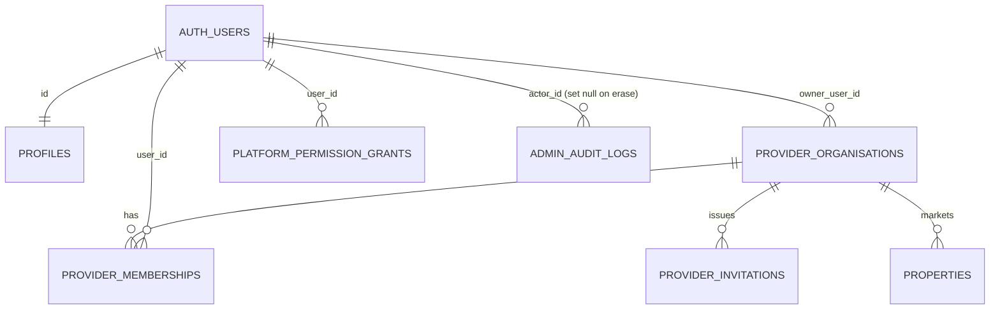
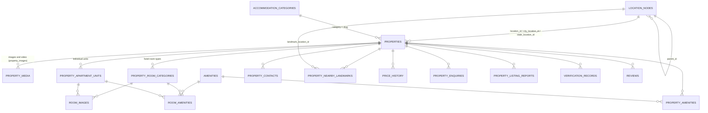
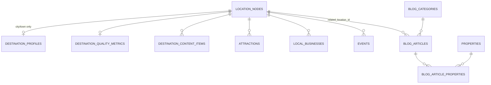
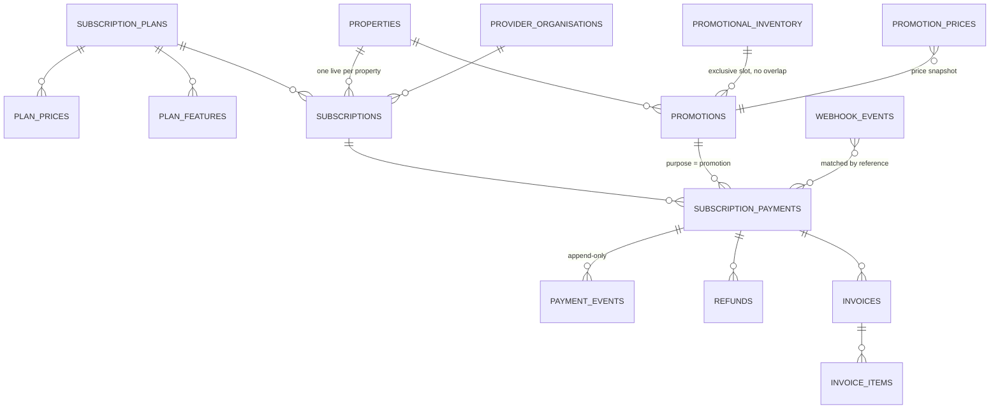
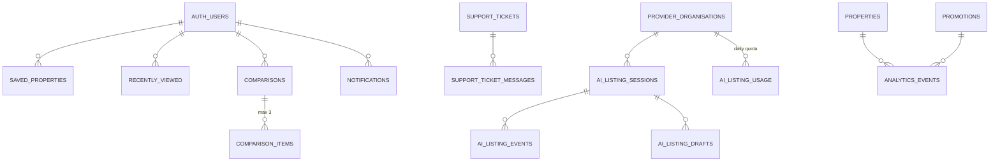

# Hotelnearby ERD (target schema after migrations 001-012)

Mermaid diagrams, split by domain so each stays readable. `auth.users` is Supabase Auth; `profiles` is the application "users" entity.
Dashed names are proposed in migrations 008-012 (not yet applied anywhere).

## 1. Identity and tenancy

## 2. Listings and geography

## 3. Destinations, directories and journal

## 4. Subscriptions, payments, promotions (Paystack: platform fees only)

## 5. Visitor tools, operations, AI, analytics

## Approved entity to physical table
| Approved entity | Physical table | Note |
|---|---|---|
| users | `auth.users` + `profiles` | rename not recommended |
| organisations / organisation_members | `provider_organisations` / `provider_memberships` | keep names |
| locations / landmarks | `location_nodes` (level = landmark) + `property_nearby_landmarks` | linked by `landmark_location_id` |
| property_images | `property_media` | also holds video |
| room_categories / apartment_units | `property_room_categories` / `property_apartment_units` | keep names |
| enquiries | `property_enquiries` | |
| destinations | `destination_profiles` (+ metrics, content items) | |
| audit_logs | `admin_audit_logs` | broadened to system actors |
| AI listing sessions/drafts | `ai_listing_sessions`, `ai_listing_events`, `ai_listing_usage`, **`ai_listing_drafts`** | drafts new |
| all others | same name as the approved entity | new in 009-012 |
